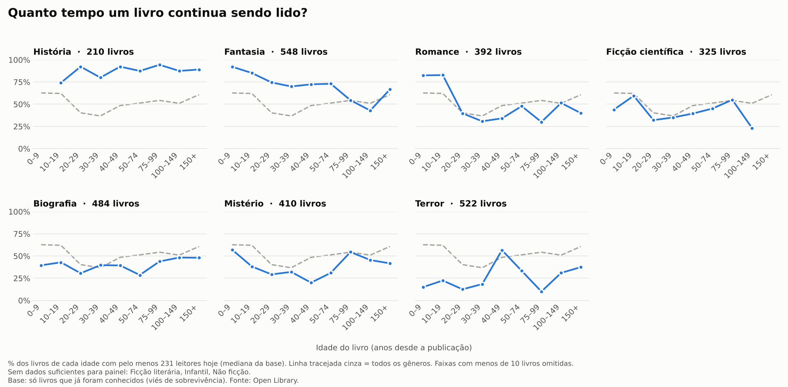

# Book Trends

Coleta e acompanhamento da **popularidade de livros ao longo do tempo** a partir
da [Open Library](https://openlibrary.org/). A cada execução é gerado um
*snapshot* das métricas de cada livro (quantas pessoas querem ler, estão lendo,
já leram, nota média etc.), e esses snapshots são guardados no histórico — o que
permite estudar como a popularidade **cresce mês a mês**.

O projeto é um pequeno pipeline **ETL** (Extract → Transform → Load) que salva
tudo em CSV, pronto para visualizar em Power BI, Python ou Tableau.

---

## Pipeline

```text
Open Library (search.json)
        │  etapas/coletar.py: GET paginado por gênero × amostra (readinglog, readinglog_pt), até 2020
        ▼
   JSON bruto  ──►  raw/AAAA-MM/openlibrary_AAAA-MM-DD.csv
        │  normalização
        ▼
   processed/livros.csv           (foto mais recente)
   processed/livros_generos.csv   (relação livro × gênero)
        │  histórico
        ▼
   historico/AAAA-MM/livros_AAAA-MM.csv   (snapshots do mês)
        │  etapas/merge.py (merge Google Books)
        ▼
   processed/livros_merged.csv                    (foto mais recente + gb_*)
   historico/AAAA-MM/livros_merged_AAAA-MM.csv    (histórico + gb_*)
        │  etapas/consolidar.py (junta todos os meses)
        ▼
   historico/livros_consolidado.csv
   historico/livros_merged_consolidado.csv
        │  etapas/tratar.py (limpa, junta works duplicados, marca os conhecidos)
        ▼
   historico/livros_tratado.csv  +  processed/livros_analise.csv  +  processed/livros_top.csv
        │  etapas/traduzir_titulos.py (título da edição em português, com cache)
        ▼
   processed/livros_analise.csv  (+ titulo_exibicao, titulo_pt, titulo_pt_fonte)
        │  etapas/perfis.py (classifica cada livro conhecido)
        ▼
   processed/perfis_livros.csv  +  analise/AAAA-MM/perfis_AAAA-MM-DD.csv
        │  etapas/sobrevivencia.py (curva de sobrevivência por gênero)
        ▼
   processed/sobrevivencia.csv  +  analise/graficos/sobrevivencia_por_genero.png
        │
        ▼
   Power BI / Python / Tableau
```

### Pastas separadas por mês

`raw/`, `historico/`, `logs/` e `analise/` têm uma subpasta por mês
(`2026-09/`, `2026-10/`, ...). Ficam na raiz só as "fotos atuais"
(`processed/`) e os consolidados (`historico/livros_consolidado.csv` etc.),
que juntam todos os meses.

Se você já tinha arquivos soltos do formato antigo, rode uma vez:

```bash
python scripts/organizar_pastas.py
```

Ele move cada arquivo para a pasta do mês certo. Nada se perde: se o
destino já existir, o histórico é combinado (sem duplicar) e o log é
anexado; um `raw` do mesmo dia é mantido no lugar com um aviso.

---

## Estrutura do projeto

```text
PI-6-DataView/
├── run_diario.py                 # rotina completa (é o que o agendador roda)
├── requirements.txt
├── booktrends/                   # o código do pipeline
│   ├── config.py                 # tudo que costuma mudar (gêneros, limites, pastas)
│   ├── logging_setup.py          # log no console + arquivo datado
│   ├── utils/texto.py            # normalização de texto, ISBN, listas → texto
│   ├── extract/                  # EXTRACT: chamadas às APIs
│   │   ├── openlibrary.py        #   busca paginada, edições de um work
│   │   └── googlebooks.py        #   busca por ISBN e por título em pt
│   ├── transform/                # TRANSFORM: regras sobre os dados
│   │   ├── normalizar.py         #   JSON da Open Library → esquema do projeto
│   │   ├── merge_google_books.py #   junta os campos gb_* (com cache)
│   │   ├── tratamento.py         #   limpeza, duplicados, gênero principal, flags
│   │   └── titulos.py            #   títulos em português (com cache)
│   ├── load/
│   │   └── csv_writer.py         # LOAD: grava CSV e histórico sem duplicar
│   └── etapas/                   # cada etapa da rotina, com seu main()
│       ├── coletar.py            #   1. coleta da Open Library
│       ├── merge.py              #   2. merge com o Google Books
│       ├── consolidar.py         #   3. junta os meses do histórico
│       ├── tratar.py             #   4. base tratada para análise
│       ├── traduzir_titulos.py   #   5. títulos em português
│       ├── perfis.py             #   6. perfis de popularidade
│       └── sobrevivencia.py      #   7. curva de sobrevivência
├── dados/correcoes_livros.csv    # correções manuais (versionadas)
├── docs/                         # imagens do README
└── scripts/
    ├── run_daily.ps1             # wrapper do Agendador de Tarefas do Windows
    └── organizar_pastas.py       # migração única do formato antigo de pastas
```

| Quero mudar…                           | Arquivo                                  |
| -------------------------------------- | ---------------------------------------- |
| Gêneros, limites, pasta de saída, ritmo | `booktrends/config.py`                   |
| Paginação / rate limit / requisições   | `booktrends/extract/openlibrary.py`      |
| Esquema dos dados coletados            | `booktrends/transform/normalizar.py`     |
| Limpeza, duplicados, gênero principal  | `booktrends/transform/tratamento.py`     |
| Gênero ou ano de um livro específico   | `dados/correcoes_livros.csv`             |
| Regras dos perfis                      | `booktrends/etapas/perfis.py`            |
| Gravação dos CSVs                      | `booktrends/load/csv_writer.py`          |

---

## Requisitos

- Python 3.9+
- Bibliotecas: `pip install -r requirements.txt`
  (requests, pandas, python-dotenv, matplotlib)

---

## Como rodar

Sempre a partir da raiz do repositório.

Rotina completa (coleta → merge → consolidação → tratamento → títulos →
perfis → curva), que é o que o agendador roda:

```bash
python run_diario.py
```

Uma etapa sozinha:

```bash
python -m booktrends.etapas.coletar
python -m booktrends.etapas.merge
python -m booktrends.etapas.consolidar
python -m booktrends.etapas.tratar
python -m booktrends.etapas.traduzir_titulos
python -m booktrends.etapas.perfis
python -m booktrends.etapas.sobrevivencia
```

Os arquivos são gravados na pasta `BOOK_TRENDS_DIR` do `.env` (ex.:
`BOOK_TRENDS_DIR=G:/Meu Drive/book-trends`) ou, sem ela, em `./data`. As
subpastas `raw/`, `processed/`, `historico/` etc. são criadas sozinhas.

---

## Configuração

Tudo que costuma mudar está em `booktrends/config.py`:

| Constante          | O que faz                                                        |
| ------------------ | ---------------------------------------------------------------- |
| `BASE_DIR`         | Pasta onde os CSVs são salvos                                    |
| `CONTACT_EMAIL`    | E-mail de contato (vai no `User-Agent`, exigido pela Open Library) |
| `GENEROS`          | Mapa `nome do gênero → termo de busca` a coletar                 |
| `LIMIT_POR_PAGINA` | Resultados por página (máx. 100)                                 |
| `MAX_PAGINAS`      | Páginas por gênero (padrão 20 → até ~2.000 livros por gênero)    |
| `ORDENACOES`       | Ordenações coletadas e nº de páginas de cada (ver abaixo)        |
| `PAUSA_SEGUNDOS`   | Pausa entre requisições (educação com a API)                    |
| `FIELDS`           | Campos pedidos à API (inclui os de popularidade)                |

---

## Arquivos gerados

| Arquivo                          | Conteúdo                                                        |
| -------------------------------- | -------------------------------------------------------------- |
| `raw/AAAA-MM/openlibrary_AAAA-MM-DD.csv` | Resposta bruta da API (para auditoria)                 |
| `processed/livros.csv`           | Uma linha por livro, no esquema do projeto (foto mais recente) |
| `processed/livros_generos.csv`   | Relação livro × gênero (um livro pode ter vários gêneros)      |
| `processed/livros_merged.csv`    | `livros.csv` enriquecido com os campos `gb_*` do Google Books (foto mais recente, gerado por `etapas/merge.py`) |
| `historico/AAAA-MM/livros_AAAA-MM.csv` | Snapshots do mês — é o que permite estudar a tendência   |
| `historico/AAAA-MM/livros_merged_AAAA-MM.csv` | Mesmo histórico acumulado, já com os campos `gb_*` (gerado por `etapas/merge.py`) |
| `historico/livros_consolidado.csv` | **Todos os meses juntos num único arquivo** — aponte o Power BI para este (gerado por `etapas/consolidar.py`) |
| `historico/livros_merged_consolidado.csv` | Mesma coisa, já com os campos `gb_*`                     |
| `processed/perfis_livros.csv`    | Um livro por linha com o **perfil de popularidade** (gerado por `etapas/perfis.py`) |
| `analise/AAAA-MM/perfis_AAAA-MM-DD.csv` | Cópia datada dos perfis, guardada por mês             |
| `logs/AAAA-MM/coleta_AAAA-MM-DD.log` | Log de cada execução                                     |

### Esquema de `livros.csv`

| Coluna              | Descrição                                            |
| ------------------- | ---------------------------------------------------- |
| `id_livro`          | ID do work na Open Library (ex.: `OL45804W`)         |
| `isbn`              | ISBN (preferência por ISBN-13)                       |
| `titulo`            | Título                                               |
| `autor` / `autor_id`| Autor(es) e respectivos IDs                          |
| `ano_publicacao`    | Ano da primeira publicação                           |
| `generos`           | Gêneros do livro (agrupados, separados por `;`)      |
| `editora`           | Editora                                              |
| `paginas`           | Nº mediano de páginas                                |
| `idioma`            | Idioma(s)                                            |
| `nota_media`        | Nota média (ratings)                                 |
| `qtd_avaliacoes`    | Quantidade de avaliações                             |
| `qtd_edicoes`       | Quantidade de edições                                |
| `want_to_read`      | Pessoas que querem ler                               |
| `currently_reading` | Pessoas lendo atualmente                             |
| `already_read`      | Pessoas que já leram                                 |
| `cover_id` / `url_capa` | ID e URL da capa                                 |
| `amostra`           | Ordenação(ões) em que o livro veio (`key`, `new`, `readinglog`) |
| `data_coleta`       | Data do snapshot (`AAAA-MM-DD`)                      |

O histórico não duplica o mesmo livro na mesma `data_coleta`, então rodar a
coleta duas vezes no mesmo dia é seguro. Se quiser mais de um ponto por período,
rode em datas diferentes — a série temporal se forma pela combinação
`id_livro + data_coleta`.

---

## Amostragem (`AMOSTRAS`)

A Search API devolve os resultados numa ordem e só pagina até certo ponto.
Cada amostra em `booktrends/config.py` define ordenação, idioma e nº de páginas por gênero:

| Amostra         | O que traz                                             |
| --------------- | ------------------------------------------------------ |
| `readinglog`    | Livros mais presentes nas estantes dos leitores (principal, obrigatória) |
| `readinglog_pt` | Mesma ordenação, só obras com edição em português      |

Todas filtram `first_publish_year` até `ANO_MAX_PUBLICACAO` (2020).

Até nov/2026 a amostra principal era `key` (IDs mais antigos da Open
Library), que trazia sobretudo livros obscuros: metade da base tinha 0
leitores. O histórico antigo continua lá; o `etapas/tratar.py` filtra os livros
desconhecidos na hora da análise.

---

## Tratamento (`etapas/tratar.py`)

Lê `historico/livros_consolidado.csv` e aplica as regras de
`booktrends/transform/tratamento.py`:

- descarta IDs que não são de obra (`...M`, de edição);
- ano impossível (0, 9183...) vira vazio; tipos inteiros (`Int64`);
- contador de leitores ausente vira 0; `nota_media` fica vazia quando não há avaliações;
- `autor_principal` = primeiro nome da lista de autores;
- **works duplicados** da Open Library (mesmo título + autor normalizados)
  viram uma obra só: leitores, avaliações e edições somados, menor ano,
  IDs originais em `ids_agrupados`;
- flags `conhecido` (≥ `MIN_LEITORES` leitores **ou** ≥ `MIN_EDICOES` edições),
  `no_periodo` (publicado até 2020) e `tem_pt` (tem edição em português).

Saídas: `historico/livros_tratado.csv` (série completa),
`processed/livros_analise.csv` (uma linha por obra conhecida, aponte o BI
para este) e `processed/livros_top.csv` (30 mais lidos por gênero, para
conferir a base).

---

## Gênero principal e correções manuais

Os gêneros da coleta vêm das tags (`subject`) da Open Library, que erram
muito (Harry Potter vinha como História e Mistério). O `etapas/tratar.py` cria:

- `genero_principal`: um gênero por obra;
- `genero_fonte`: `manual` (da tabela) ou `automatico` (pela regra).

**`dados/correcoes_livros.csv`** (versionado no repositório) tem o gênero
certo dos 300 livros mais lidos e, quando a Open Library erra, o ano de
publicação (ex.: *Lolita* vinha como 1777). Para corrigir outro livro, é só
acrescentar uma linha (`id_livro, titulo, autor, genero_principal,
ano_publicacao`); `titulo` e `autor` servem só de referência.

Além dos 7 gêneros da coleta, a tabela usa três que não existem nas tags:
**Ficção literária**, **Não ficção** e **Infantil**.

Para os outros livros, o gênero principal é o primeiro da `ORDEM_GENEROS`
(`booktrends/config.py`) entre os da Open Library. A ordem foi escolhida testando
todas as combinações contra a tabela manual: acerta 84% dos livros cujo
gênero existe na Open Library. O ponto fraco é "História", que nos livros
populares costuma ser ficção literária ou não ficção: para análises
finas, filtre `genero_fonte == "manual"` ou amplie a tabela.

---

## Google Books (`etapas/merge.py`)

Enriquece os livros com sinopse, categorias, nota e páginas do Google Books,
consultando por ISBN. Cada ISBN é consultado uma vez só e guardado em
`cache/googlebooks.json`.

- A fila começa pelos **livros conhecidos** de `processed/livros_analise.csv`
  (da rodada anterior), dos mais lidos para os menos lidos, e só depois
  segue pelos outros livros da coleta, dos mais desejados para os menos.
- `GB_MAX_LIVROS` (500) limita só as **consultas novas** de cada rodada. O
  que já está no cache é aplicado a todos os livros sem contar no limite,
  então a cobertura cresce todo dia.
- O log mostra quantos livros conhecidos já têm dados e quantos faltam.

---

## Títulos em português (`etapas/traduzir_titulos.py`)

Sem tradução automática: título traduzido ao pé da letra sai errado
(*Nineteen Eighty-Four* é *1984* no Brasil). O título vem de uma edição
real em português (`booktrends/transform/titulos.py`):

1. **Open Library**: edições do próprio work em `por`; fica o título mais
   frequente entre elas (só obras com `tem_pt`).
2. **Google Books**: busca título + autor com `langRestrict=pt`; só aceita
   se o sobrenome do autor bater.
3. Senão, fica o original.

Colunas: `titulo_exibicao` (use esta nos gráficos), `titulo_pt` e
`titulo_pt_fonte` (`openlibrary`, `google_books`, `original`). As respostas
ficam em `cache/titulos_pt.json`, então cada obra é consultada uma vez.
Cada rodada consulta até `TITULOS_MAX_POR_RODADA` obras (das mais lidas
para as menos lidas), e no máximo `TITULOS_GB_MAX` delas no Google Books,
para não estourar a cota diária junto com o `etapas/merge.py`.

---

## Perfis de popularidade (`etapas/perfis.py`)

Para responder *por que alguns livros continuam sendo lidos décadas depois
e outros desaparecem*, cada livro conhecido recebe um perfil. "Leitores" =
`want_to_read + currently_reading + already_read`; nº de edições mede a
relevância passada (só é reeditado o que teve procura).

Cada livro é comparado com os do **mesmo período de publicação**: um livro
de 1950 com 200 edições é comparado com outros de 1950, não com um de 2015.
Os períodos são décadas; as antigas são juntadas até ter 50 livros
(`até 1659`, `1660–1799`...). `pct_leitores_periodo` e `pct_edicoes_periodo`
(0 a 1) dizem a posição do livro dentro do período.

| Perfil                   | Regra                                                                   |
| ------------------------ | ----------------------------------------------------------------------- |
| Clássico vivo            | Até 1976, no quartil de cima do período em edições **e** em leitores    |
| Esquecido                | Até 1996, edições acima da mediana do período, leitores no quartil de baixo |
| Redescoberto / em alta   | Até 1996, top 10% de crescimento em 30 dias (e ≥ 3 leitores novos)      |
| Fenômeno recente         | De 1997 em diante, top 10% de leitores do período                      |
| Estável                  | O resto: conhecido, sem destaque                                        |

Roda sozinho no fim do `run_diario.py`, depois do `etapas/tratar.py`. O
crescimento só é calculado para livros presentes na última coleta e vistos
em 2+ datas (`dias_acompanhado`); `crescimento_pct_30d` normaliza por mês.
O perfil "Redescoberto" fica mais confiável quanto mais meses de histórico houver.

---

## Curva de sobrevivência (`etapas/sobrevivencia.py`)

*Quanto tempo um livro continua sendo lido?* Para cada faixa de idade
(`FAIXAS_IDADE`, anos desde a publicação) e cada gênero principal, calcula
a fração de livros **vivos**: com pelo menos `LIMIAR_VIVO` leitores hoje.
Com `LIMIAR_VIVO = None`, o limiar é a mediana de leitores da base.

- `processed/sobrevivencia.csv`: `genero`, `faixa_idade`, `livros`, `vivos`,
  `pct_vivos`, `exibir` (faixa com pelo menos `MIN_LIVROS_PONTO` livros) e
  `limiar_leitores`; inclui a linha "Todos os gêneros".
- `analise/graficos/sobrevivencia_por_genero.png`: um painel por gênero,
  com a curva geral tracejada como referência.



*Gráfico gerado com o histórico de set–nov/2026.*

**Viés de sobrevivência:** a base só tem livros que um dia foram conhecidos
(`MIN_LEITORES` / `MIN_EDICOES`). A curva mede quantos desses continuam
lidos com o tempo, não a chance de qualquer livro publicado sobreviver.
Gêneros com poucos livros por faixa (hoje Ficção literária, Infantil e
Não ficção, que só existem na tabela manual) ficam fora do gráfico, mas
continuam no CSV.

---

## Observações importantes

- **User-Agent obrigatório.** A Open Library bloqueia coleta anônima. O
  `CONTACT_EMAIL` no `booktrends/config.py` vira o `User-Agent` das requisições.
- **Campos de popularidade só vêm se pedir.** `ratings_*`,
  `want_to_read_count`, `currently_reading_count` e `already_read_count` só
  aparecem porque estão listados em `FIELDS`. Sem isso, essas colunas viriam
  vazias.
- **A API não é para bases gigantes de uma vez.** A `search.json` limita
  paginação profunda; puxar dezenas de milhares num único run não é o caminho.
  Aqui a base cresce pelo **histórico**, sobre um conjunto focado de gêneros.
  Para um dump estático enorme, a via seria o dump mensal da Open Library.

---
## Fonte de dados

Dados da [Open Library](https://openlibrary.org/), um projeto do Internet
Archive. Catálogo sob licença **CC0** (domínio público).
